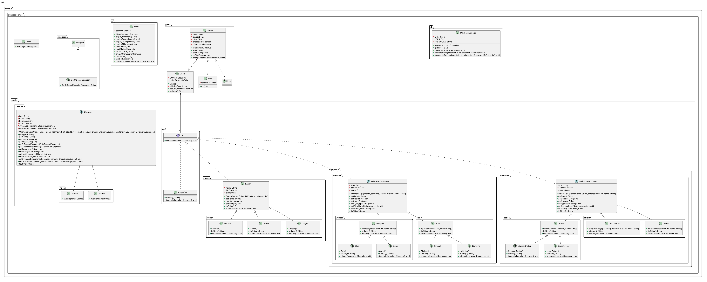
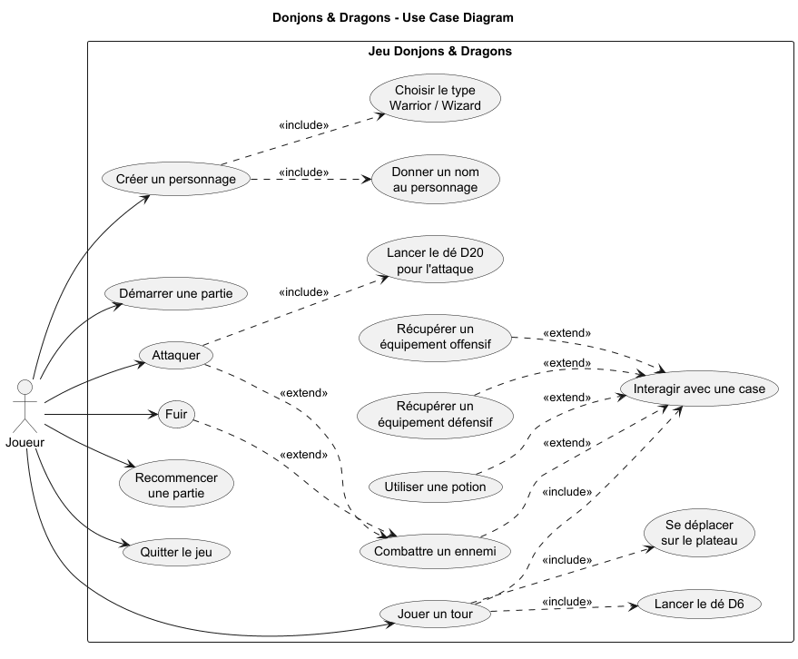

# Dungeon Crawler Java — Donjons & Dragons

Projet Java en ligne de commande inspiré de **Donjons & Dragons**. Le joueur crée un héros, avance sur un plateau de 64 cases, récupère des équipements et des potions, affronte différents ennemis et tente d’atteindre la dernière case en restant en vie.

Le projet met en pratique les principaux concepts de la programmation orientée objet en Java : héritage, abstraction, interfaces, polymorphisme, exceptions, collections et séparation des responsabilités.

## Fonctionnalités

- Création d’un personnage : **Warrior** ou **Wizard**
- Choix et modification du nom du personnage
- Plateau de **64 cases** généré avec un ordre aléatoire
- Déplacement avec un **dé à 6 faces (D6)**
- Différents types de cases : ennemis, équipements, potions et cases vides
- Ennemis : **Goblin**, **Sorcerer** et **Dragon**
- Équipements offensifs : **Club**, **Sword**, **Lightning** et **Fireball**
- Potions de soin : **Standard Potion** et **Large Potion**
- Combat au tour par tour
- Utilisation d’un **dé à 20 faces (D20)** pour gérer les attaques critiques
- Possibilité d’attaquer ou de fuir pendant un combat
- Gestion du dépassement du plateau avec une exception personnalisée `OutOfBoardException`
- Possibilité de recommencer une partie
- Documentation JavaDoc et diagrammes UML

## Personnages

| Personnage | Points de vie | Attaque de base | Équipement offensif initial |
|---|---:|---:|---|
| Warrior | 10 | 5 | Club (+3) |
| Wizard | 7 | 7 | Lightning (+2) |

## Ennemis

| Ennemi | Points de vie | Force |
|---|---:|---:|
| Goblin | 6 | 1 |
| Sorcerer | 9 | 2 |
| Dragon | 15 | 8 |

## Règles principales

À chaque tour, le joueur lance un **D6** pour avancer sur le plateau. Lorsqu’il arrive sur une case, l’action dépend de son contenu :

- une case vide n’a aucun effet ;
- une potion peut restaurer des points de vie ;
- un équipement offensif compatible peut remplacer l’équipement actuel s’il est plus puissant ;
- un ennemi déclenche un combat.

Pendant un combat, le personnage attaque en premier. Le **D20** détermine le résultat de l’attaque :

- `1` : échec critique, aucun dégât ;
- `20` : réussite critique, bonus de `+2` aux dégâts ;
- `2 à 19` : attaque normale.

Si l’ennemi survit, il attaque à son tour selon le même principe. Le joueur peut ensuite continuer le combat ou fuir. En cas de fuite, il recule d’un nombre de cases déterminé par le D6.

La partie est gagnée lorsque le personnage atteint la case 64 en restant en vie.

## Structure du projet

```text
src/fr/campus/dungeoncrawler/
├── Main.java
├── db/
│   └── DatabaseManager.java
├── exception/
│   └── OutOfBoardException.java
├── game/
│   ├── Board.java
│   ├── Game.java
│   └── Dice/
│       ├── Dice.java
│       ├── SixSidedDice.java
│       └── TwentySidedDice.java
├── model/
│   ├── cell/
│   ├── character/
│   ├── enemy/
│   └── equipment/
└── ui/
    └── Menu.java
```

### Organisation

- `Main` : point d’entrée de l’application et création des dépendances principales.
- `Game` : gestion du déroulement de la partie, des déplacements et des combats.
- `Board` : création et gestion des 64 cases du plateau.
- `Cell` : interface commune aux éléments pouvant être placés sur le plateau.
- `Character` : classe abstraite commune à `Warrior` et `Wizard`.
- `Enemy` : classe de base des ennemis.
- `OffensiveEquipment` / `DefensiveEquipment` : classes abstraites pour les équipements.
- `Dice` : interface implémentée par les dés D6 et D20.
- `Menu` : affichage des menus et lecture des choix du joueur.

## UML

Le projet contient les diagrammes UML dans `docs/UML/`.

### Diagramme de classes

Le diagramme de classes présente les principales classes du jeu, leurs attributs, leurs méthodes et leurs relations.



### Diagramme de Use Case

Le diagramme de Use Case présente les principales fonctionnalités du jeu du point de vue du joueur.



Les fichiers sources PlantUML sont également disponibles :

- `docs/UML/class-diagram.puml`
- `docs/UML/use-case-diagram.puml`

## JavaDoc

Une documentation JavaDoc générée est disponible dans :

```text
docs/javadoc/index.html
```

Ouvrir ce fichier dans un navigateur permet de consulter la documentation des principales classes du projet.

## Technologies utilisées

- **Java 17+**
- Programmation orientée objet
- IntelliJ IDEA
- PlantUML
- JavaDoc
- JDBC / MySQL pour la partie persistance expérimentale

## Prérequis

Pour exécuter le jeu :

- JDK **17 ou supérieur** installé ;
- un IDE Java comme IntelliJ IDEA est recommandé.

Le jeu principal fonctionne sans base de données.

## Lancer le projet avec IntelliJ IDEA

1. Cloner le dépôt :

```bash
git clone https://github.com/gheisariyeh/dungeon-crawler-java.git
```

2. Ouvrir le dossier `dungeon-crawler-java` dans IntelliJ IDEA.
3. Configurer le **Project SDK** avec Java 17 ou supérieur.
4. Vérifier que le dossier `src` est reconnu comme **Sources Root**.
5. Ouvrir :

```text
src/fr/campus/dungeoncrawler/Main.java
```

6. Exécuter la méthode `main()`.

## Lancer le projet depuis PowerShell

Depuis la racine du projet :

```powershell
New-Item -ItemType Directory -Force out | Out-Null
$sources = Get-ChildItem -Path src -Recurse -Filter *.java | ForEach-Object { $_.FullName }
javac -d out $sources
java -cp out fr.campus.dungeoncrawler.Main
```

## Base de données

Le projet contient également une classe `DatabaseManager` utilisant **JDBC/MySQL** pour expérimenter la persistance des héros : lecture, création et mise à jour.

Cette partie n’est actuellement **pas connectée au déroulement principal du jeu** : les appels à la base de données sont désactivés dans `Game`. Elle n’est donc pas nécessaire pour lancer et jouer au jeu.

Pour l’utiliser, il faut disposer d’une base MySQL adaptée et configurer les paramètres de connexion dans `DatabaseManager` sans conserver de mot de passe réel dans le dépôt Git.

## Concepts Java mis en pratique

Ce projet permet notamment de travailler :

- les classes et les objets ;
- l’héritage ;
- les classes abstraites ;
- les interfaces ;
- le polymorphisme ;
- les collections avec `ArrayList` ;
- les exceptions personnalisées ;
- l’utilisation de `instanceof` ;
- la séparation du modèle, de la logique de jeu et de l’interface console ;
- la documentation avec JavaDoc ;
- la modélisation UML.

## Améliorations possibles

- Ajouter des tests unitaires avec JUnit
- Connecter complètement la persistance MySQL au jeu
- Externaliser la configuration de la base de données
- Améliorer la validation des entrées utilisateur
- Séparer davantage la logique de combat de la classe `Game`
- Ajouter un outil de build comme Maven ou Gradle
